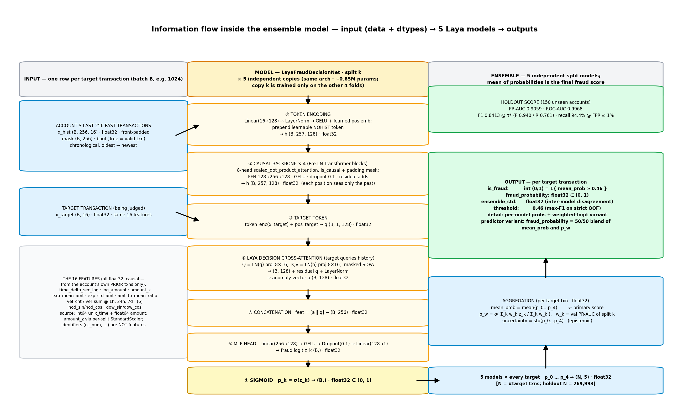

# Laya Fraud Ensemble

A 5-model ensemble of sequence-aware ("Laya") decision nets that judge whether a **target
transaction is fraudulent (1) or normal (0)** from the account's full prior transaction
history. Trained on an anonymized synthetic banking dataset: **1,852,394 transactions,
999 accounts, 9,651 fraud (0.521%)**.

<p align="center">
  
</p>

## Results — locked holdout (15% of accounts, 269,993 rows, 1,452 fraud)

| Model | PR-AUC | ROC-AUC | F1 @ τ\* | Precision @ τ\* | Recall @ τ\* |
|---|---|---|---|---|---|
| Best single split (split_0) | 0.8935 | 0.9962 | — | — | — |
| **Ensemble (mean prob)** | **0.9059** | **0.9968** | **0.8413** | **0.9404** | **0.7610** |
| Ensemble (PR-AUC-weighted logit) | 0.9048 | 0.9968 | 0.8409 | 0.9427 | 0.7590 |

- **Ensemble gain: +0.0124 PR-AUC** over the best single model.
- Thresholds derived from strict out-of-fold (OOF) dev predictions (each of the 1,582,401 dev
  rows scored by the model that held its account out): **τ\* = 0.46** (max F1, OOF F1 0.8401 ≈
  test 0.8413 — no threshold overfit) and **τ = 0.1645** (recall **94.4%** at FPR ≤ 1%,
  precision 36.5% — expected at a 0.54% base rate).
- Per-model epistemic uncertainty (std of the 5 probabilities): mean 0.0066 overall,
  0.079 in the |p−0.5|<0.15 boundary band.

## Architecture — `LayaFraudDecisionNet` (~0.65M params)

1. **Feature encoder**: Linear → LayerNorm → GELU + learned positional embeddings over the
   account's last **L=256** prior transactions (front-padded, masked) plus the target txn.
2. **Causal backbone**: 4-layer Transformer encoder using
   `F.scaled_dot_product_attention(..., is_causal=True)` over the history.
3. **Laya decision head**: the target transaction queries the encoded history via
   cross-attention (anomaly vector), concatenated with the target's own features → MLP →
   one binary fraud logit $z_k$.

16 input features per transaction, **all causal** (computed from the account's prior
transactions only, verified against an oracle recomputation): `time_delta_sec_log`,
`log_amount`, `amount_z` (per-split z-score), `exp_mean_amt`, `exp_std_amt`,
`amt_to_mean_ratio`, velocity count/sum over prior 1h/24h/7d, hour/day-of-week sin/cos.
Raw identifiers (`cc_num`, names, addresses) are used **only** for grouping and splitting —
never as model inputs.

## Data & splits (leakage-free)

- **Holdout test**: 150 of 999 accounts (15%) carved out first → `data/test.parquet`
  (`fold = -1`). Never trained on, never used for threshold tuning.
- **Dev**: remaining 849 accounts (1,582,401 rows) → `data/dev.parquet`, partitioned into 5
  folds by `StratifiedGroupKFold(n_splits=5, shuffle=True, random_state=42)` grouped by
  `cc_num`, stratified by `is_fraud`. Each split *k*: train = the other 4 folds,
  val = fold *k*. An account's history never crosses a train/val boundary.
- `data/fold_mapping.parquet` — account → partition/fold. `data/meta.json` — feature
  contract and split constants.

## Install

```bash
pip install -r requirements.txt
```

Phases 3–4 require a single GPU (any CUDA device; trained on 1× NVIDIA H200 with
bfloat16). Set `CUDA_VISIBLE_DEVICES` to your GPU id. Phases 1–2 and 5 are CPU-only.

## Pipeline (run in order)

```bash
export CUDA_VISIBLE_DEVICES=0          # whichever single GPU you use
python 01_inspect_data.py              # schema/imbalance report -> logs/data_inspection_report.json
python 02_preprocess_and_split.py      # causal features + 5 folds + holdout -> data/
python 03_train_5fold_laya.py          # 5 splits × 6 epochs (~35 min on H200) -> checkpoints/ + oof_split_k.npz
python 04_ensemble_infer_and_eval.py   # ensembles, thresholds, report (~2 min) -> ensemble_evaluation_report.json
python 05_make_figures.py               # CPU-only: 5 figures -> figures/
```

Phases 1–2 need the raw CSVs at `<parent>/data/raw_archive/{fraudTrain,fraudTest}.csv`
(see `RAW_DIR` at the top of `02_preprocess_and_split.py`); the raw data is **not**
included in this repo. Phases 3–4 run entirely on the processed `data/*.parquet` that is
included, so you can retrain/reevaluate from this checkout as-is.

Training config: focal loss (γ=2), AdamW (lr 3e-4, wd 1e-2), cosine LR, bfloat16 autocast,
`torch.compile`, `DataLoader(num_workers=8, pin_memory=True)`, per-split feature scalers
(fit on that split's train only), best checkpoint per split by validation PR-AUC, seed
`42 + split`.

## Standalone predictor

```python
from laya_ensemble_predictor import predict_transaction
import pandas as pd

# an account's prior transactions, chronological
hist = pd.DataFrame({"unix_time": [1600000000, 1600003600, 1600007200],
                     "amt": [42.10, 15.75, 990.00]})
out = predict_transaction(hist)
# {'is_fraud': 0, 'fraud_probability': 0.031, 'ensemble_std': 0.011, 'threshold': 0.46}
```

Loads all 5 checkpoints + per-split scalers, recomputes the causal features, and returns
the blended ensemble probability (mean of the 5 model probabilities, weighted-logit
variant in `out["detail"]`), the inter-model std as an uncertainty score, and the OOF
threshold.

## Figures

`python 05_make_figures.py` (CPU-only) regenerates `figures/` from the committed
`test_probs.npz` / `oof_ensemble.npz` + `ensemble_evaluation_report.json`:

- `fig1_pr_curves_holdout.png` — Precision-Recall, holdout: ensemble vs the 5 single
  splits (PR-AUC 0.9059 vs best single 0.8935).
- `fig2_roc_curves_holdout.png` — ROC, holdout (ROC-AUC 0.9968).
- `fig3_threshold_operating_points.png` — Precision/recall vs threshold with the two
  OOF-derived operating points: τ\*=0.46 (max F1) and τ=0.1645 (recall @ FPR≤1%).
- `fig4_separation_and_confusion.png` — fraud-vs-normal predicted-probability separation
  and the confusion matrix at τ\*.
- `fig5_pipeline_flow.png` — information flow **inside the ensemble model**: input
  tensors (`x_hist` (B,256,16) f32 + mask bool, `x_target` (B,16) f32, 16 causal
  features with dtypes) → the 7 stages of `LayaFraudDecisionNet` (× 5 independent split
  models) → p_0..p_4 → ensemble aggregation → per-transaction output (`is_fraud`,
  `fraud_probability`, `ensemble_std`, `threshold`).

## Repo layout

```
01_inspect_data.py 02_preprocess_and_split.py 03_train_5fold_laya.py
04_ensemble_infer_and_eval.py 05_make_figures.py
laya_model.py laya_ensemble_predictor.py
data/          dev.parquet test.parquet fold_mapping.parquet meta.json
checkpoints/   laya_split_{0..4}_best.pt  val_pr_auc.json
oof_split_{0..4}.npz oof_ensemble.npz test_probs.npz
logs/          data_inspection_report.json train_*.log/jsonl eval_all.log
figures/       fig1..fig5 (PR/ROC curves, thresholds, confusion, pipeline flow)
ensemble_evaluation_report.json
```

## Notes

- Threshold τ\* is F1-optimal on the OOF ensemble; at a 0.52% base rate, high-precision
  operation (P≈0.94) and high-recall operation (R≈0.94 @ FPR≤1%) sit at different thresholds
  — both are reported.
- Checkpoints store weights + config + per-split scaler + validation PR-AUC (used as the
  ensemble weighting).
